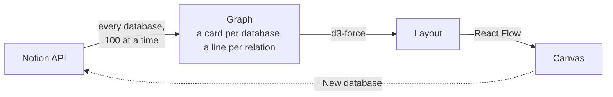

<div align="center">

# NotionViz

**Your Notion workspace as a map: every database and every relation, at once.**

A web app that draws the databases of a Notion workspace as a graph, so you can
see how they connect, inspect any of them, and create new ones with their
relations already in place.

</div>

<br>

> **Runs with your own Notion connection.** NotionViz signs in through Notion's
> OAuth, so running it means creating a public connection in Notion and giving
> the app its keys. It takes a few minutes: [run it locally](#run-it-locally).

<br>


<br>

## Why

Notion workspaces grow one database at a time. After a while nobody remembers
that Meetings points at Projects, or that the relation between Tasks and People
only goes one way, and the only way to find out is to open every database and
read its properties.

NotionViz reads the whole workspace in one pass and draws it: a card for each
database with its properties, a line for each relation. A two-way relation is a
single line with an arrow at each end, so the shape of the workspace is visible
before you click anything.

## What you can do

- **See the whole workspace.** Every database you share with NotionViz, placed by a force simulation so that related databases sit close together. Pan, zoom, and find your way with the minimap.
- **Follow a relation.** Point at a relation property inside a card: its line and the database it points to light up.
- **Inspect a database.** Click a card to see when it was last edited, which databases it links to and which link to it, and its five most recently edited entries, each one a link into Notion.
- **Inspect a relation.** Click a line to see the two databases, the property behind it, whether it's two-way, and the matching property on the other side.
- **Create a database.** The **+** button opens a form: choose a parent page, an emoji and a name, then add properties of 15 types, including number formats, select options in Notion's colours, one- or two-way relations to databases already on the map, formulas and unique IDs. NotionViz creates the database in Notion and adds it to the graph, relations included.
- **Light or dark.** Dark by default. The toggle switches to a light theme close to Notion's own.

## Run it locally

You need **Node.js 20.9 or newer** and a Notion account.

**1. Create a public connection in Notion.** In the
[Developer portal](https://app.notion.com/developers/connections), go to
**Build → Connections → Create new connection** and set:

- **Installation scope:** Any workspace
- **Redirect URI:** `http://localhost:3000/api/auth/notion/callback`
- **Capabilities:** read content, to draw the graph, and insert content, to create databases

Then copy the **OAuth client ID** and **OAuth client secret** from the
**Configuration** tab.

**2. Install and configure.**

```bash
git clone https://github.com/lucadebort/notion-viz.git
cd notion-viz
npm install
```

Create a `.env.local` file in the project folder:

```bash
NOTION_CLIENT_ID=your-client-id
NOTION_CLIENT_SECRET=your-client-secret
NOTION_REDIRECT_URI=http://localhost:3000/api/auth/notion/callback
```

The redirect URI has to match the one in the Developer portal exactly.

**3. Start it.**

```bash
npm run dev
```

Open [localhost:3000](http://localhost:3000) and press **Connect Notion
workspace**. Notion asks which pages to share: NotionViz sees the databases
inside those pages and nothing else.

To switch to another workspace, use the exit icon in the chip at the top left.

## How it works



- **Sign-in.** OAuth with Notion. The access token lives in an httpOnly cookie in your browser for 30 days. NotionViz has no database of its own, so nothing about your workspace is stored on a server.
- **Reading.** On each load NotionViz asks Notion's search API for every database you shared, a page of 100 at a time. Each database becomes a card. Each relation property becomes a line, a pair of two-way properties becomes one line, and relations that point at databases you didn't share are left out.
- **Layout.** A d3-force simulation pulls related databases together and keeps the cards from overlapping, starting from positions on a circle so the same workspace settles the same way every time. React Flow draws the result.
- **Writing.** Creating a database is the only thing NotionViz writes. It never edits or deletes anything already in your workspace.

Built with Next.js 16 (App Router), React 19, React Flow, d3-force, Tailwind CSS v4 and shadcn/ui, and the official Notion SDK.

## Limits worth knowing

- **Only what you share.** Databases outside the pages you picked during sign-in don't appear, and neither do the relations that point at them.
- **A snapshot per load.** The graph is read when the page loads. Changes made in Notion show up after a reload.
- **Emoji icons only.** A database with a custom image icon shows without one.
- **One request for the whole workspace.** Every database is read before the graph appears, so a large workspace takes longer to open.

## License

MIT. See [LICENSE](LICENSE).
